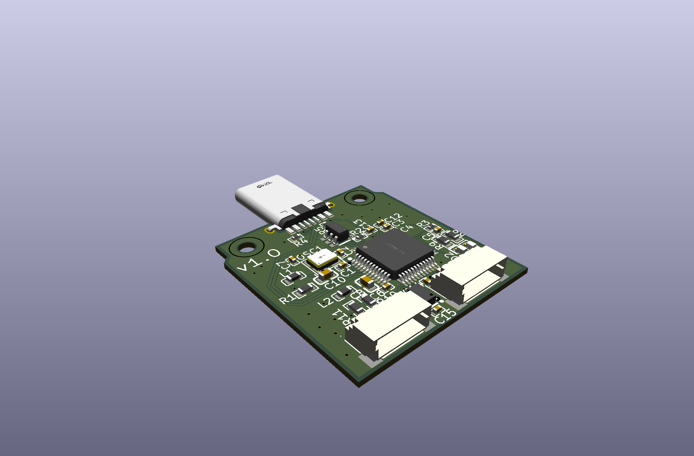
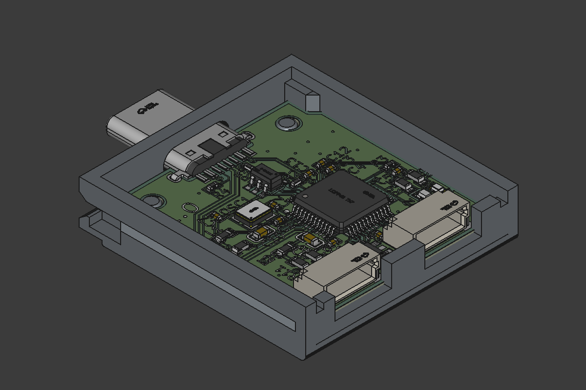
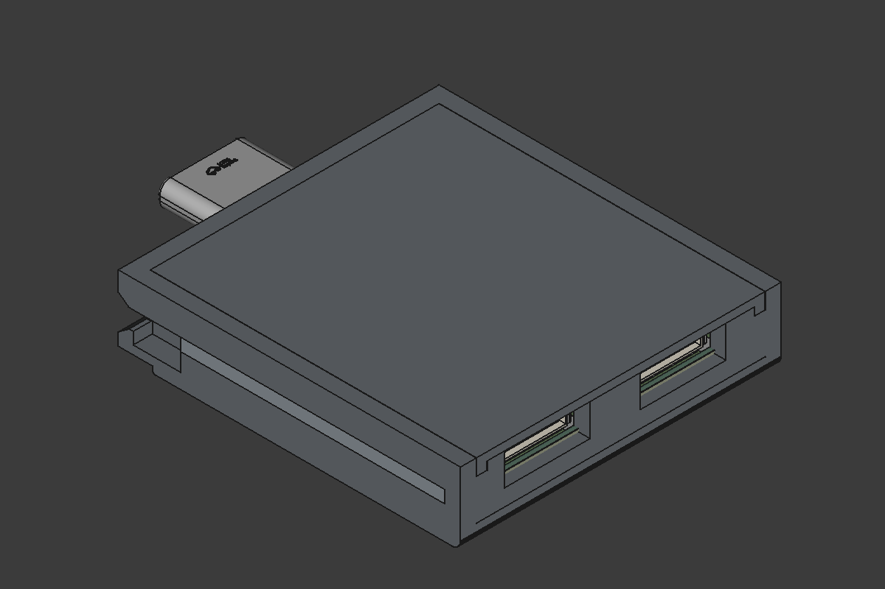

# USB-to-Multipurpose-Framework-Expansion-Card
This repository contains schematic, pcb design, production files and 3D case for custom made FT232H (USB to Multipurpose
UART/FIFO IC) Framework Expansion card.

## Repository structure

```text
.
├── usb_to_multipurpose/       # KiCad project (the actual board design)
├── 3D_models/                 # Enclosure and card models
├── images/                    # Renders used in this README
└── schematic_v1.0.pdf         # Exported schematic
```

### Third-party content

- `ExpansionCards/`: [Framework's Expansion Card repository](https://github.com/FrameworkComputer/ExpansionCards) (`Electrical`, `Mechanical`, licence files) with the mechanical and electrical specs of the card form factor.

# PCB Renders





