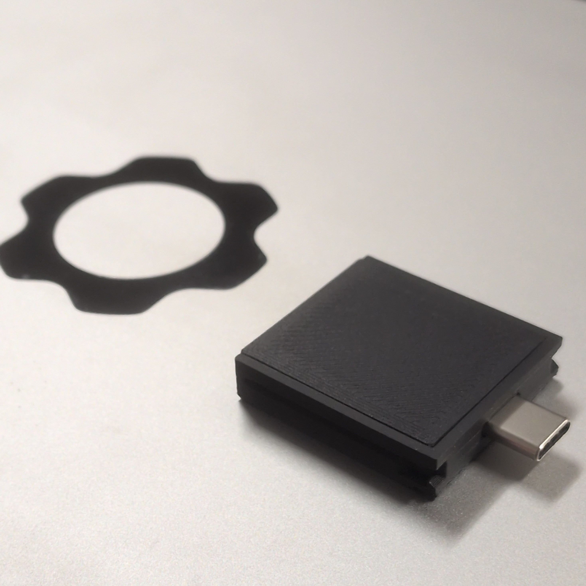
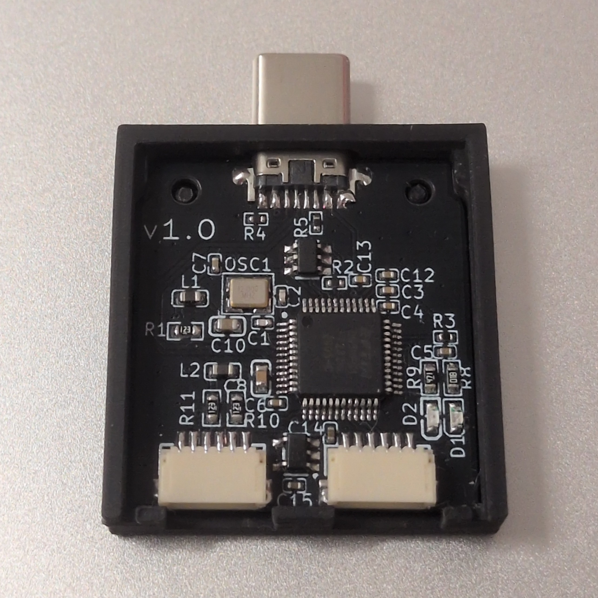
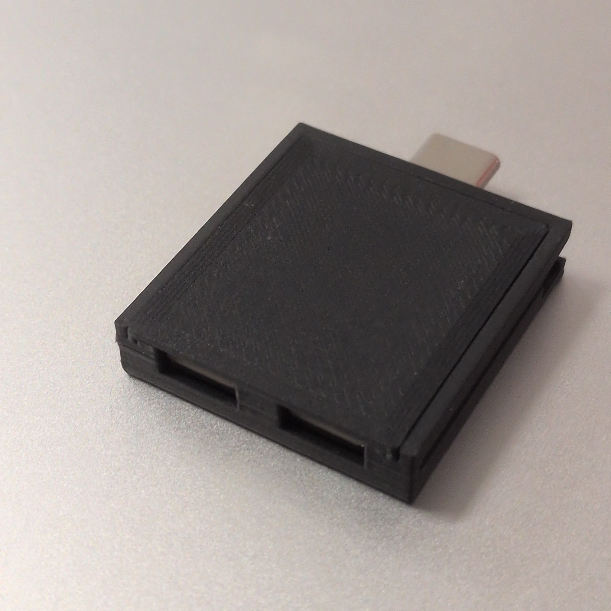
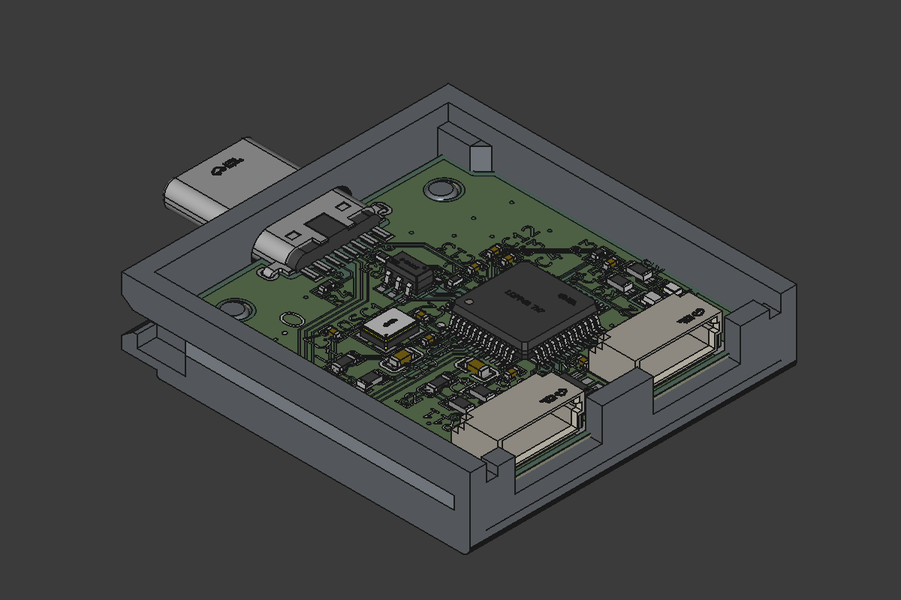

# USB-to-Multipurpose-Framework-Expansion-Card
A custom Framework Laptop Expansion Card that exposes an FTDI FT232H (USB to Multipurpose UART/FIFO IC). Examples of applications:
- USB to UART
- USB to SPI
- USB to I²C
- USB to Bit-Bang
- and more ...




## Table of Contents
- [Pinout](#pinout)
- [Repository structure](#repository-structure)
- [Third-party resources](#third-party-resources)
- [Gallery](#gallery)
- [Credits](#credits)
- [License](#license)

## Pinout
According to the [schematic](schematic_v1.0.pdf) card has two 6-pin JST SH connectors, **U3** and **U4**. Pin 1 is the GND pin at the left end of each connector in the PCB view.

### U3
| Pin | Signal | FT232H pin | Notes |
|-----|--------|------------|-------|
| 1 | GND | | Ground |
| 2 | +3.3V | | Supply output (from external LDO) |
| 3 | SDA/MOSI | ADBUS1 (D1) | I²C SDA / SPI MOSI |
| 4 | SCL/SCK | ADBUS0 (D0) | I²C SCL / SPI SCK |
| 5 | SDA/MISO | ADBUS2 (D2) | I²C SDA / SPI MISO |
| 6 | CS | ADBUS3 (D3) | SPI chip select |

### U4
| Pin | Signal | FT232H pin | Notes |
|-----|--------|------------|-------|
| 1 | GND | | Ground |
| 2 | +5V | | Supply output |
| 3 | D7 | ADBUS7 | GPIO |
| 4 | C0 | ACBUS0 | GPIO |
| 5 | C8 | ACBUS8 | GPIO |
| 6 | C9 | ACBUS9 | GPIO |

## Repository structure

```text
.
├── usb_to_multipurpose/       # KiCad project (the actual board design)
├── 3D_models/                 # Custom enclosure and card models
├── images/                    # Renders used in this README
├── production/                # Generated BOM, gerber, ... 
└── schematic_v1.0.pdf         # Exported schematic
```

### Third-party resources
- [Framework's Expansion Card repository](https://github.com/FrameworkComputer/ExpansionCards) (`Mechanical`): the mechanical of the card form factor. Files are located in `3D_models/ExpansionCard.*`:
- [FTDI FT232H Single Channel HiSpeed USB to Multipurpose
UART/FIFO IC datasheet](https://ftdichip.com/wp-content/uploads/2020/07/DS_FT232H.pdf): main resource for preparing the schematic and final PCB.
- [Adafruit FT232H Breakout](https://learn.adafruit.com/adafruit-ft232h-breakout/downloads): Adafruit documentation of the board that uses FT232H IC. It was used as a double check for schematic design.

## Gallery


*Finished PCB inside a case*


*Fully assembeled expansion card*


*PCB render with case*


## Credits
Great thanks ♥️ to: [Flipp4](https://github.com/Flipp4) who did a great review of the board before version 0.


## License

- Hardware design (KiCad project, schematic, production files): [CERN-OHL-P-2.0](LICENSE)
- 3D models, renders and documentation: [CC BY 4.0](LICENSE-docs)
- Framework Expansion Card mechanical files (`3D_models/ExpansionCard.*`): © 2021 Framework Computer Inc, [CC BY 4.0](https://creativecommons.org/licenses/by/4.0/). Source: [Framework repository](https://github.com/FrameworkComputer/ExpansionCards). Modified for this project's case.
